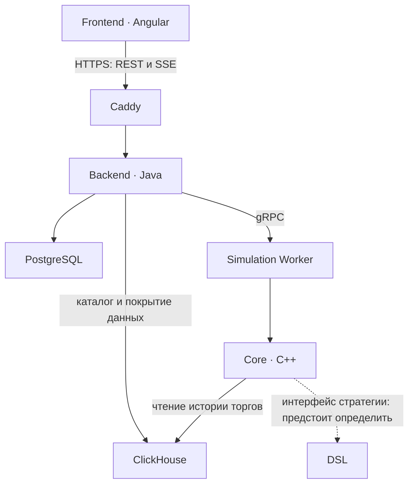

# Архитектура

Приложение состоит из интерфейса, бэкенда и вычислительного ядра. История торгов заранее загружается в локальный ClickHouse, а результаты работы сохраняются в PostgreSQL.

Отдельный репозиторий `dsl` уже создан (пока пустой): туда переедут описание языка стратегий и инструменты для работы с ним. В `core` останется симуляция ручной торговли и прогонов алгоритмов. Ниже описаны эти границы; способ подключения нового репозитория ещё предстоит определить.

## Репозитории

| Репозиторий | За что отвечает |
|---|---|
| `frontend` | Интерфейс на Angular и Taiga UI: запуск сессий, плеер, редактор стратегий, каталог, отчёты и сравнение результатов. |
| `backend` | Сервер на Java, Spring Boot и Spring Modulith: пользователи, сессии, стратегии, фоновые задания, хранение результатов и API для интерфейса. |
| `core` | Симуляция на C++20: виртуальное время, исполнение заявок, портфель, издержки, прогоны и финансовые расчёты. Здесь же остаётся Simulation Worker — gRPC-сервер, через который бэкенд обращается к вычислениям. |
| `dsl` | Описание языка, разбор текста стратегии, линтер, проверки, функции языка, интерпретатор и тесты этих инструментов. |
| `documentation` | Общие требования, инварианты, продуктовые решения, архитектура и статус проекта. |

## Как компоненты связаны

Бэкенд принимает команды пользователя и передаёт вычислительные задания воркеру. Ядро читает историю, исполняет заявки и возвращает результаты. Обновления плеера и готовые результаты приходят в интерфейс через SSE.

Пунктир показывает планируемую связь `core` и `dsl`. Конкретный способ подключения языка к ядру пока не выбран.

## Граница между core и DSL

`dsl` отвечает за смысл текста стратегии: правильно ли он написан, какие правила срабатывают, какие заявки нужно создать и что указать в `because`. Здесь находятся разбор языка, линтер, статические проверки и интерпретатор.

`core` отвечает за рынок и исполнение: какую свечу сейчас видит стратегия, сколько денег и бумаг доступно, когда исполнится заявка, какие будут комиссия, проскальзывание и результат сделки. Через одну модель исполнения проходят заявки человека и алгоритма (INV-3).

Во время симуляции:

1. Ядро предоставляет стратегии историю только до текущего момента и состояние портфеля.
2. Логика DSL вычисляет правила и возвращает заявки с причинами.
3. Ядро проверяет заявки, исполняет их на следующих свечах и обновляет портфель.

Проверки языка находятся в `dsl`, а ограничение доступа к будущим данным и контроль времени исполнения остаются обязанностью ядра (INV-1, INV-2). Денежные расчёты, издержки и метрики также остаются в `core`; Java сохраняет и передаёт готовые результаты (INV-6).

## Модули бэкенда

Бэкенд работает одним приложением. Внутри он разделён на модули с отдельными задачами.

| Модуль | Задача |
|---|---|
| `api` | Общие правила HTTP API, безопасность и обработка ошибок. |
| `identity` | Учётные записи и вход пользователя. |
| `config` | Общие настройки приложения. |
| `worker` | Связь с Simulation Worker по gRPC, передача заданий и результатов. |
| `marketdata` | Каталог бумаг и доступной истории; подбор отрезка выбранной категории периода. Саму категорию (σ/MDD) считает `core`, `marketdata` передаёт результат. |
| `workshop` | Черновики стратегий, публикация неизменяемых версий, форки и скрытие из каталога. Передача стратегии на проверку и сохранение диагностик. |
| `sessions` | Ручная торговля: журнал команд, виртуальное время, плеер, слепой режим, завершение и воспроизведение. |
| `simulation` | Очередь вычислительных заданий, прогоны алгоритмов и повтор прогона. Задание может продолжаться после закрытия вкладки. |
| `analysis` | Отчёты, история, каталог алгоритмов, сравнение результатов, разбор расхождений и выгрузка CSV/XLSX. |

## Границы модулей

- Модули общаются через свои публичные интерфейсы и события: например, завершение сессии или прогона запускает подготовку отчёта.
- В PostgreSQL у каждого модуля своя схема — группа его таблиц. Схемы и таблицы создаются миграциями; модуль работает со своими таблицами.
- Ручная сессия сохраняется как журнал команд. После перезагрузки или обрыва состояние восстанавливается проигрыванием журнала (INV-8).
- Бэкенд скрывает названия бумаг и реальные даты до завершения слепой сессии (INV-7).

## Данные

| Хранилище | Что хранится и кто обращается |
|---|---|
| PostgreSQL | Пользователи, стратегии и их версии, сессии, команды, фоновые задания, результаты и отчёты. С базой работает бэкенд. |
| ClickHouse | Локальная история минутных свечей, дневной ряд IMOEX, дневной ряд ставки RUONIA (`ruonia`), справочник бумаг `securities` (сектор, размер лота, шаг цены) и торговый календарь. Бэкенд читает каталог и покрытие, ядро — историю для симуляции. |

Данные MOEX однократно загружаются в ClickHouse скриптом подготовки вне приложения. Во время торговли источником данных служит локальный архив. Бэкенд и ядро обращаются к нему только для чтения.

Каждая сессия и прогон сохраняют ссылку на конкретную версию данных; прогоны также привязаны к версии стратегии и её параметрам. Это позволяет повторить расчёт (INV-4, INV-5).

## Контракты

| Связь | Как передаются данные | Где описан контракт |
|---|---|---|
| Интерфейс ↔ бэкенд | REST для команд и запросов, SSE для событий | `backend/api/openapi.yaml` |
| Бэкенд ↔ Simulation Worker | gRPC: `Ping`, `ReplaySession` (воспроизведение журнала и отчёт), `GetBars` (бары) | `core/proto/` (копия в `backend`) |
| Ядро ↔ логика DSL | Интерфейс проверки и выполнения стратегии | - |

## Запуск

Базовое окружение — Docker Compose: Caddy, бэкенд, Simulation Worker, PostgreSQL и ClickHouse.
